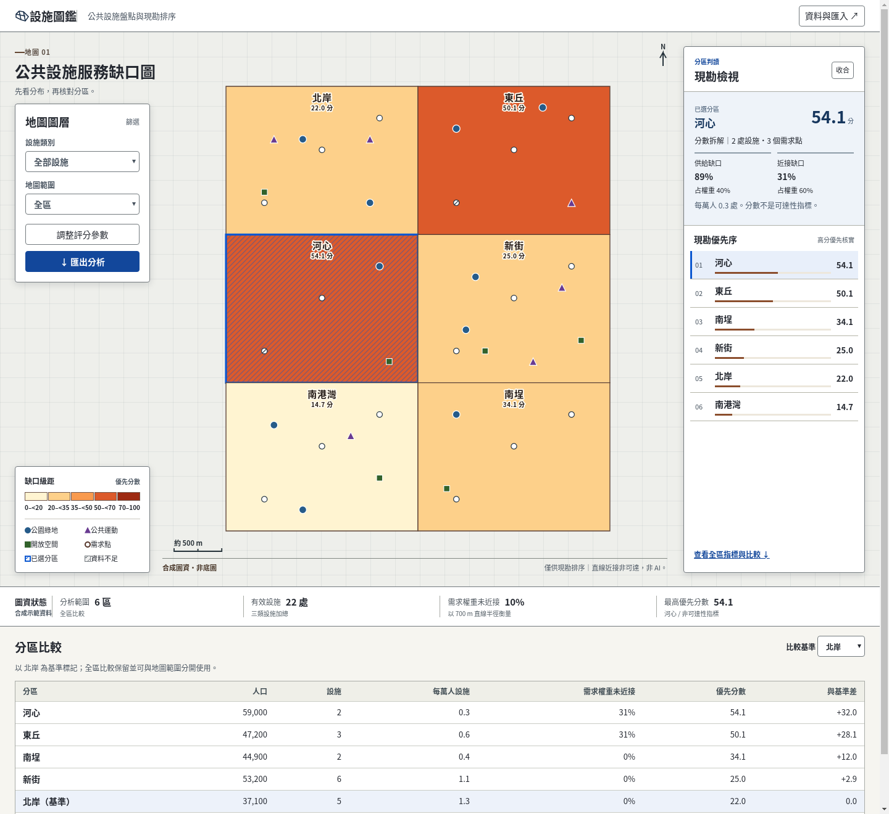

# 設施圖鑑｜公共設施服務缺口盤點

**可操作的公共 GIS 決策支援示範**。輸入分區、設施及加權需求點，得到地圖、跨區比較、可解釋的現勘排序與可攜式 GeoJSON。範例全部為合成資料，依分區篩選後，就能選定優先現勘區並匯出結果。

| 篩選實例 | 資料來源與互通 | 手機 |
|---|---|---|
| [公共運動與參數比較](screenshots/02-category-comparison.png) | [GeoJSON 匯入與來源面板](screenshots/03-geojson-provenance.png) | [390 px 手機畫面](screenshots/04-mobile.png) |

## 試用

    python3 -m http.server 8000 --bind 127.0.0.1

開啟 http://127.0.0.1:8000/。瀏覽器本地運算，無帳號、API 金鑰、套件與地圖瓦片。經 HTTP 載入 ES 模組，不支援直接開啟檔案。

1. 切換設施類別、範圍，選地圖或排序列看分數拆解。
2. 設比較基準和分數參數；用「匯出分析」保存當下範圍及參數。
3. 按「資料與匯入」，匯入 [合成 GeoJSON](data/demo.geojson) 或自有已授權資料；可另外匯出標準化原始資料。

## 交付與驗證

- [需求、驗收與部署說明](docs/requirements.md)；[製圖介面設計與可及性驗收](DESIGN.md)
- [GeoJSON 介接與演算法](docs/interoperability.md)
- [模型／資料測試](tests/model.test.mjs)：node --test tests/model.test.mjs
- [桌面及手機瀏覽器測試](tests/browser.py)：需 Python Playwright 與 Chromium，python tests/browser.py
- [Qt WebEngine 備援驗證](tests/run-qt.sh)：bash tests/run-qt.sh，需現有 Slicer 與相容 Qt 平台插件；[實測結果](docs/browser-results.json)

這是**透明的確定性規則**，不是 AI／機器學習，不判斷實際步行時間、無障礙法規符合性、營運時段或設施品質。排名只用於提出需要比對現地情況的區域。
